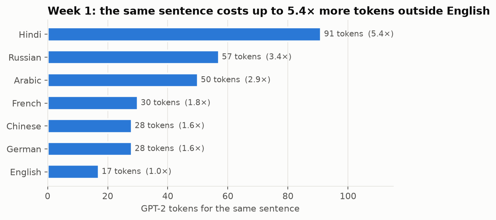

# Week 1: Transformer Mechanics

**Fellow:** Joshua Obafemi · **Full repo:** [AI-Engineering-Flow_Research](https://github.com/jorshimayor/AI-Engineering-Flow_Research) (notes, code, results and article plans for every week)

**Paper:** [Attention Is All You Need](https://arxiv.org/abs/1706.03762) (Vaswani et al., 2017)
**Lab:** probe a pretrained model's tokeniser edge cases and next-token distributions across prompts.
**Model:** GPT-2 small (124M), CPU. **Notebook:** [`week1_transformer_probing.ipynb`](week1_transformer_probing.ipynb) (about 1 minute).

## Results

| Probe | Result |
|---|---|
| Leading space | `' hello'` and `'hello'` are different tokens with separate embeddings |
| Numbers | `1234567` → `123\|45\|67`; `2026` → `20\|26` |
| Emoji | 🙂 = 2 tokens; a family emoji = 10 tokens, each decoding to `�` alone |
| Round trip | `decode(encode(s)) == s` for every string tested |
| Special tokens | The literal text `<\|endoftext\|>` becomes the real end-of-text token (injection risk) |
| Token cost | Same sentence: English 17 tokens, Hindi 91 (5.4×) |
| Trailing space | P(" Paris" \| "The capital of France is") = 3.2%, rank 5. With a trailing space: ~0%, rank 1,472 |
| Knowledge vs generation | "Paris" ranks 5th freely, but wins 87% among Paris, London, Berlin and Lyon |
| Arithmetic | `17 + 25 =` prefers 32 over 42 |
| Perplexity | Natural sentence 162; same words shuffled 7,728 |
| Attention | Layer 0 rebuilt by hand matches the model exactly; future-token weight is exactly 0 |
| Attention sinks | Share of attention on token 0 rises from 19% (layer 0) to 82% (layer 10) |
| Generation | Hand-written KV-cached loop reproduces `model.generate` exactly; greedy decoding loops |

## Findings

1. Many model quirks are tokenisation artefacts: spacing, digits, non-English cost.
2. Next-token probabilities are the whole interface. Scoring a fixed set of answers reveals knowledge that free generation hides.
3. Self-attention is `softmax(QKᵀ/√d + mask)·V`, about 10 lines of code. An attention pattern suggests a mechanism but doesn't prove one: the head that links "it" to "animal" sends almost every token to "animal".
4. GPT-2's learned position embeddings are smooth and wave-like, close to the paper's sinusoids.

## Caveats

- One small model (GPT-2 small); larger models tokenise and attend differently.
- Single prompts per probe, no statistics. Treat these as demonstrations, not measurements of a population.
