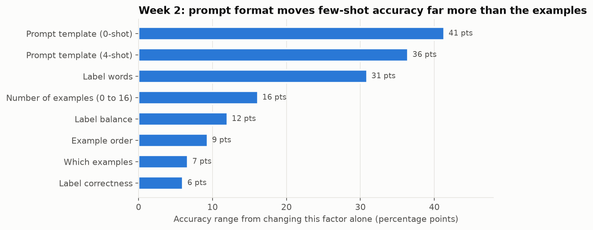

# Week 2: Context, Sampling and In-Context Learning

**Fellow:** Joshua Obafemi · **Full repo:** [AI-Engineering-Flow_Research](https://github.com/jorshimayor/AI-Engineering-Flow_Research) (notes, code, results and article plans for every week)

**Paper:** [Language Models are Few-Shot Learners](https://arxiv.org/abs/2005.14165) (Brown et al., 2020)
**Lab:** vary few-shot examples (count, order, format) on a fixed task and document what moves output quality.
**Setup:** Qwen2.5-0.5B (base), SST-2 sentiment, the same 150 test reviews in every run, label log-prob scoring. 140 configurations.
**Notebook:** [`week2_in_context_learning.ipynb`](week2_in_context_learning.ipynb) · **Code:** [`src/icl.py`](src/icl.py)

## Results

| Factor varied | Effect |
|---|---|
| Number of examples (k) | 0: 87.3%, 1: 73.9%, 4: 85.5%, 16: 90.0%. Standard deviation across demo sets falls from 10.4 to 0.9 points |
| Order (24 orderings of 4 examples, 2 demo sets) | 81% to 91%. A positive last example raises positive predictions by 11 points |
| Template | 4-shot accuracy from 48.7% ("question" template) to 85.1% ("review") |
| Label words | great/terrible 89.1%, positive/negative 85.1%, 0/1 58.2%, foo/bar 71.6% |
| Label correctness (k = 8) | Gold 89.6%, random 88.4%, all flipped 83.6% |
| Label balance | Positive predictions rise from 33% to 67% as positive examples go from 0 to 4 |
| Label mass (probability on valid answers) | 0.62 at k = 0, 0.99 at k = 16 |
| Sampling at temperature 1 | P(correct label): 47.5% at 0-shot, 77.1% at 4-shot |
| Context | GPT-2 fails at token 1,025. Passkey retrieval: 100% up to 8,192 tokens |

## Findings

1. Format matters most: the template and label words moved accuracy by up to 41 points; order, choice of examples and label correctness by 6 to 9.
2. Examples mainly teach the answer format: label mass goes from 0.62 to 0.99.
3. A 0.5B model follows its prior, not the example labels: with every label flipped it still scores 84% (as Wei et al., 2023 found for small models).
4. Contextual calibration fixed a template that collapsed onto "negative" (97% of predictions) but broke arbitrary labels like foo/bar.
5. For classification, sample at temperature near 0.

## Week 4 audit

Re-tested with paired statistics in Week 4 ([audit](https://github.com/jorshimayor/AI-Engineering-Flow_Research/blob/main/notes/week_4/README.md#audit-of-week-2-and-3-claims)):
- **Hold:** one example is worse than none; random labels barely matter; flipped labels hurt; the model ignores flipped labels; calibration effects; recency bias.
- **Not established:** 16 examples beat 0 (+2.7 points, CI −1.7 to +7.3); great/terrible beats positive/negative; the "question" template is below chance (48.7%, CI includes 50%).

## Caveats

- One small model and an easy task. Order effects are larger for harder tasks in the literature.
- 150 test items: differences under about 5 points are within noise.
- The passkey test is a copy task, too easy to show long-context limits.
