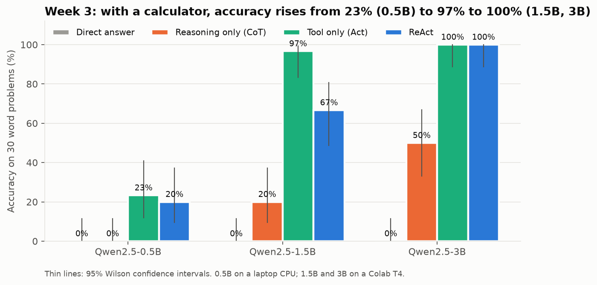
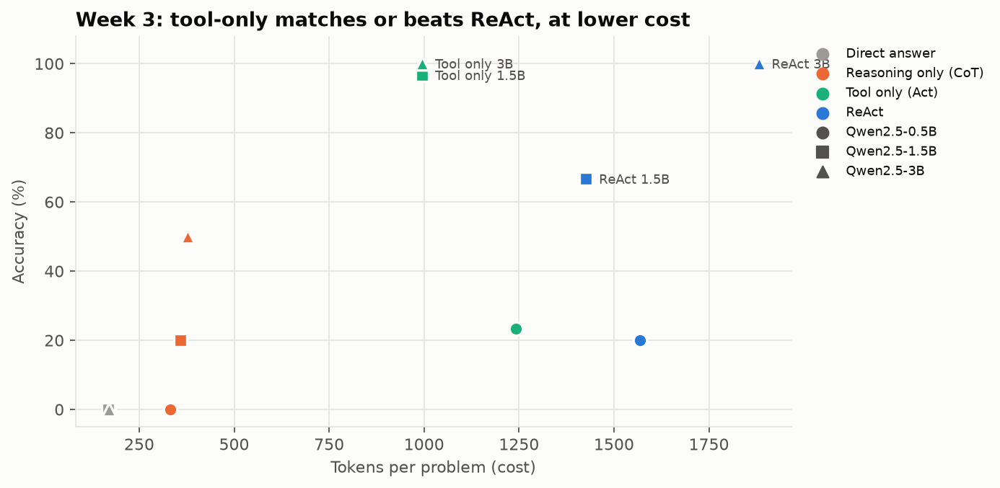

# Week 3: Reasoning and Tool-Use Foundations

**Fellow:** Joshua Obafemi · **Full repo:** [AI-Engineering-Flow_Research](https://github.com/jorshimayor/AI-Engineering-Flow_Research) (notes, code, results and article plans for every week)

**Paper:** [ReAct: Synergizing Reasoning and Acting in Language Models](https://arxiv.org/abs/2210.03629) (Yao et al., 2022)
**Lab:** hand-implement a minimal single-tool ReAct-style loop on a small task.
**Agent:** [`src/react_agent.py`](src/react_agent.py), about 100 lines, one calculator tool, no framework.
**Task:** 30 two-step word problems with 3-to-4-digit numbers (for example `7511 * 77 - 1331`).
**Notebooks:** [`week3_react_agent.ipynb`](week3_react_agent.ipynb) (0.5B, CPU) · [`week3_colab.ipynb`](week3_colab.ipynb) (1.5B and 3B, Colab T4)

## How the agent works

1. The model writes `Thought:` and `Action: calculate[expr]`; generation stops at `Observation:`.
2. The code evaluates the expression with a safe parser (never `eval`) and appends the real result.
3. Repeat until `Action: finish[answer]`, up to 6 steps.

The four modes from the paper differ only in trajectory format: direct answer, reasoning only (CoT), tool only (Act), ReAct.

## Results

| Model | Direct | CoT | Act | ReAct | ReAct − Act (95% CI) | Tokens ReAct / Act |
|---|---|---|---|---|---|---|
| Qwen2.5-0.5B | 0% | 0% | 23% | 20% | −3.3 (−16.7 to +10.0) | 1.26× |
| Qwen2.5-1.5B | 0% | 20% | 97% | 67% | −30.0 (−50.0 to −13.3), p = 0.012 | 1.43× |
| Qwen2.5-3B | 0% | 50% | 100% | 100% | 0 | 1.89× |

## Findings

1. **The calculator does the work.** Act-only goes from 23% to 97% to 100% with model size. Without a tool, even 3B reaches only 50%.
2. **Tools change how models fail.** Wrong CoT answers are near misses (median 4.9% off: "606 × 42 = 25,592", true 25,452). Wrong tool answers are wrong plans (median 89% to 97% off).
3. **At 1.5B the reasoning trace introduced the errors.** All 10 ReAct failures came from two templates:
   - **train:** the Thought dropped "for 46 days" and computed `577 + 647`.
   - **library:** the model invented tools (`add[...]`, `subtract[...]`) and did arithmetic in its head.
4. **At 3B both modes hit the ceiling**, and ReAct cost 1.89× the tokens. On cost and accuracy, Act-only dominates.
5. **The stop sequence matters.** Without `stop=["Observation:"]`, the model writes its own fake observation.

## Why the 0.5B model failed

| Cause | Evidence |
|---|---|
| Can't do big arithmetic | Direct and CoT: 0 of 30 |
| Can't turn the question into the right expression | 40 of 47 failed tool-using runs had a wrong expression, e.g. `4584 * 10` for "140 employees × $4,584 × 10 months" |
| Copies the prompt examples | 9 of 13 successes were on the template shaped like an example. For ReAct alone: 4 of 5 vs 2 of 25 elsewhere (Fisher exact p = 0.015) |

## Caveats

- 30 problems from 6 templates: the 1.5B gap comes from 2 templates. The Week 4 audit found this sample too small (10% power) to settle ReAct vs Act.
- Greedy decoding, one model family, problem shapes overlapping the prompt examples.
- This is why Week 4 designs a larger, held-out, pre-registered test.
