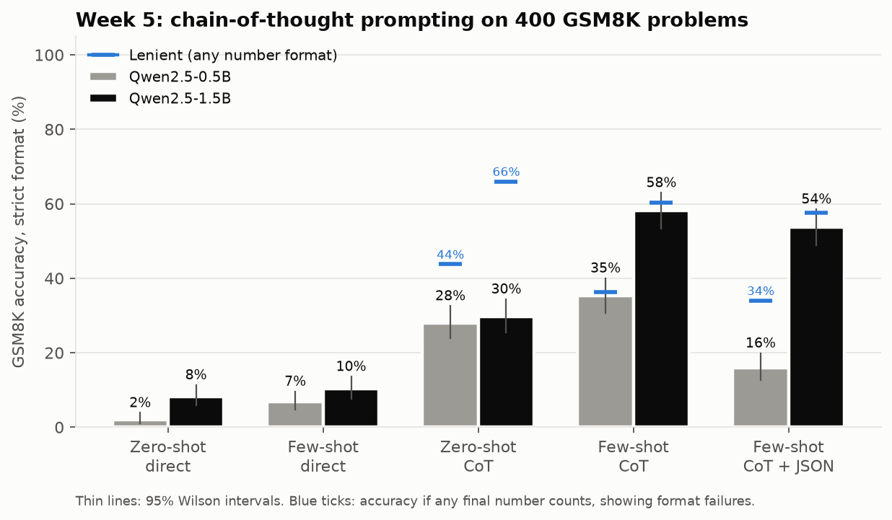
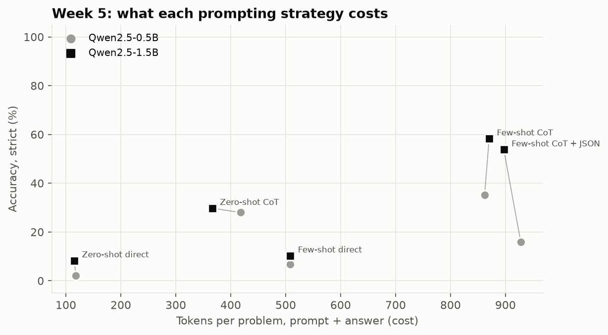

# Week 5: Systematic Prompt Engineering

**Fellow:** Joshua Obafemi · **Full repo:** [AI-Engineering-Flow_Research](https://github.com/jorshimayor/AI-Engineering-Flow_Research) (notes, code, results and article plans for every week)

**Paper:** [Chain-of-Thought Prompting Elicits Reasoning in Large Language Models](https://arxiv.org/abs/2201.11903) (Wei et al., 2022)
**Lab:** build a small prompt library for a fixed task, comparing three or more strategies with documented deltas.
**Code:** [`src/prompts.py`](src/prompts.py) (library) · [`src/gsm8k.py`](src/gsm8k.py) (data) · [`src/run_prompt_bench.py`](src/run_prompt_bench.py) (batched runner)
**Notebook:** [`week5_prompt_library_colab.ipynb`](week5_prompt_library_colab.ipynb) · [open in Colab](https://colab.research.google.com/github/jorshimayor/AI-Engineering-Flow_Research/blob/main/jupyter/week5_prompt_library_colab.ipynb) (about 40 minutes on a free T4)

**Status:** done. Plan committed before the run; test run on a Colab T4, 28 October 2026.

## The paper in brief

| | |
|---|---|
| Method | Few-shot prompts whose examples show intermediate reasoning steps, not just answers |
| Main result | Large gains on GSM8K and other reasoning benchmarks for models around 100B parameters (PaLM 540B: 18% to 57% on GSM8K) |
| Scale claim | Below roughly 10B parameters, chain-of-thought gave little or no gain, or hurt |
| Why test it now | Modern small models are instruction-tuned on reasoning data. Does the scale threshold still hold at 0.5B and 1.5B? |

## The prompt library

| Strategy | Prompt | Output the parser requires |
|---|---|---|
| `zero_shot_direct` | Instruction only | `The answer is N.` |
| `few_shot_direct` | 8 worked examples showing only answers (the paper's "standard prompting"; **baseline**) | `The answer is N.` |
| `zero_shot_cot` | Instruction plus "Let's think step by step." (Kojima et al., 2022) | Reasoning, then `The answer is N.` |
| `few_shot_cot` | 8 worked examples with reasoning steps (Wei et al., 2022) | Reasoning, then `The answer is N.` |
| `few_shot_cot_json` | Same examples, output as JSON | `{"reasoning": "...", "answer": N}` |

- The 8 examples are original, in the paper's style. Every step was checked by script.
- Chat models get the examples as alternating user and assistant turns.
- Decoding: greedy, a 512-token budget for every reasoning strategy, 24 tokens for direct answers.

Scoring:
- **strict:** the answer in the requested format (the primary metric)
- **lenient:** the last number in the output, whatever the format
- The gap between strict and lenient is the cost of format failures.

## Plan (fixed before the test run)

**Data:** 400 GSM8K test problems (fixed seed). Prompts and parsers were developed only on GSM8K **train** problems (`gsm8k.dev()`). The test set is run once.

**Models:** Qwen2.5-0.5B-Instruct and Qwen2.5-1.5B-Instruct.

| | Hypothesis | Test | Supported if |
|---|---|---|---|
| **H1** (confirmatory) | Few-shot CoT beats few-shot direct by at least 10 points, at each size | Exact McNemar, paired bootstrap CI, Holm across the 2 models | Holm p < 0.05, CI lower bound > 0, effect ≥ 10 points |
| **H2** (confirmatory) | Asking for JSON costs little: few-shot CoT JSON within ±5 points of plain few-shot CoT (strict) | Paired bootstrap 95% CI | Whole CI inside ±5 points. Outside it in either direction: a real structure tax or gain |
| Exploratory | Zero-shot vs few-shot; strict vs lenient; format-failure rates; tokens per answer (cost) | Wilson CIs, paired CIs | Reported, no significance claims |

**Power:** the paper and the Week 3 runs suggest direct answering scores far below reasoning (at least 20 points apart), so 400 paired problems gives more than 99% power for H1. For H2 the CI half-width is expected to be about 4 points, enough to establish equivalence only if the true gap is near zero.

**Changes made on dev before freezing** (library v1.1): the answer-line parser accepts LaTeX wrappers the model adds (`the answer is \( \boxed{9} \)`). The reasoning budget was raised from 384 to 512 tokens after truncated outputs.

## Results

400 GSM8K test problems, the same problems for every strategy. Strict accuracy with 95% Wilson intervals; lenient counts any final number.

| Strategy | 0.5B strict | 0.5B lenient | 1.5B strict | 1.5B lenient | Answer tokens (0.5B / 1.5B) |
|---|---|---|---|---|---|
| Zero-shot direct | 2.0% (1.0 to 3.9) | 2.5% | 8.2% (5.9 to 11.4) | 8.2% | 10 / 7 |
| Few-shot direct (baseline) | 6.8% (4.7 to 9.6) | 6.8% | 10.2% (7.6 to 13.6) | 10.2% | 7 / 7 |
| Zero-shot CoT | 28.0% (23.8 to 32.6) | 43.8% | 29.8% (25.5 to 34.4) | 66.0% | 302 / 250 |
| Few-shot CoT | **35.2%** (30.7 to 40.1) | 36.2% | **58.2%** (53.4 to 63.0) | 60.2% | 93 / 101 |
| Few-shot CoT + JSON | 16.0% (12.7 to 19.9) | 34.0% | 53.8% (48.9 to 58.6) | 57.5% | 120 / 89 |

### Confirmatory

| | Model | Difference (95% CI) | Discordant pairs | Holm p | Verdict |
|---|---|---|---|---|---|
| **H1:** few-shot CoT − few-shot direct | 0.5B | +28.5 (+23.0 to +34.0) | 134 vs 20 | < 10⁻²⁰ | **Supported** |
| | 1.5B | +48.0 (+42.8 to +53.2) | 200 vs 8 | < 10⁻⁴⁷ | **Supported** |
| **H2:** JSON − plain few-shot CoT (strict) | 0.5B | −19.3 (−24.3 to −14.3) | 17 vs 94 | | **Structure tax:** whole CI below −5 |
| | 1.5B | −4.5 (−9.3 to +0.3) | 41 vs 59 | p = 0.089 (unadjusted) | **Inconclusive:** CI crosses −5, so equivalence is not shown |

**H1** holds at both sizes, and even the CI lower bounds clear the 10-point bar. Wei et al. saw little gain below about 10B parameters. That threshold does not hold for these instruction-tuned models: chain-of-thought helps at 0.5B.

**H2** depends on size. At 0.5B, asking for JSON cost 19 points. At 1.5B the cost is between 9 points and none; 400 problems can't say which.

### Exploratory (no significance claims)

1. **The JSON tax at 0.5B is a format failure, not a reasoning failure.** Scored leniently, JSON trails plain CoT by only 2.3 points (CI −7.0 to +2.5). 62% of its JSON outputs did not parse or had no numeric `answer` field.
2. **Zero-shot CoT reasons well but ignores the answer format.** It ends with `\boxed{3200}` or "Cindy had a total of 27 eggs." instead of "The answer is N." (46% format failures at 0.5B, 59% at 1.5B). Scored leniently, it beats few-shot CoT at both sizes: +7.5 points at 0.5B (CI +2.0 to +13.0) and +5.8 at 1.5B (CI +0.3 to +11.0).
3. **So the worked examples mainly buy format and brevity.** Few-shot CoT writes 2.5 to 3.2 times fewer answer tokens than zero-shot CoT (101 vs 250 at 1.5B) and almost always follows the format.
4. **Direct answering fails at both sizes** (2% to 10%). Examples without reasoning barely help: GSM8K needs the intermediate steps.
5. **Cost.** Few-shot prompts add about 650 prompt tokens per problem, but prompt tokens are cheaper than answer tokens and can be cached. Per correct answer at 1.5B, few-shot CoT uses 174 answer tokens against 842 for zero-shot CoT.
6. At 0.5B, zero-shot direct ignored "do not show any working" in 35% of answers and ran out of its 24-token budget mid-sum.

### Caveats

- One model family, two sizes, greedy decoding, 400 of the 1,319 test problems.
- Lenient scoring takes the last number in the output, which can credit a coincidence. It is used only for exploratory points.
- The comparison with Wei et al. crosses model generations: this run cannot separate instruction tuning from scale.
- One hand-written set of 8 examples. Week 2 found example choice alone moves accuracy by 6 to 9 points.

**What would settle H2 at 1.5B:** if the true cost is near the observed 4.5 points, no sample size will show equivalence within ±5. The useful question is whether the cost is real: detecting a 4.5-point drop with 80% power needs about 1,010 paired problems (25% discordance), which the full 1,319-problem test set covers. Constrained JSON decoding (for example, Outlines) would test whether the 0.5B tax disappears once the format is guaranteed.
