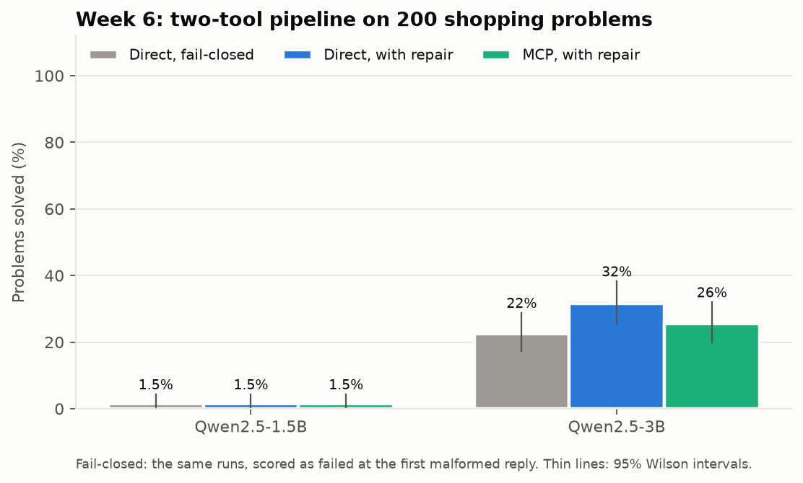
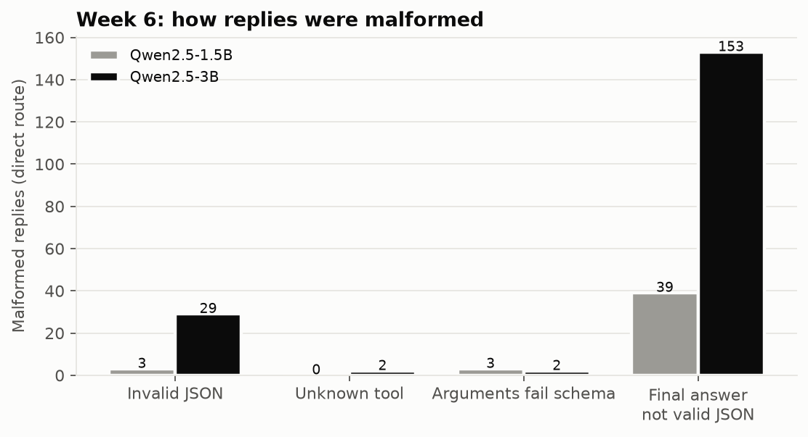

# Week 6: Structured Outputs, Tool Calling and MCP

**Fellow:** Joshua Obafemi · **Full repo:** [AI-Engineering-Flow_Research](https://github.com/jorshimayor/AI-Engineering-Flow_Research) (notes, code, results and article plans for every week)

**Papers:** [Toolformer](https://arxiv.org/abs/2302.04761) (Schick et al., 2023) · [Model Context Protocol specification](https://modelcontextprotocol.io/specification/latest) (Anthropic, 2024)
**Lab:** build a two-tool calling pipeline with schema validation and malformed-output handling, then re-expose the same tools behind an MCP server and compare the integration effort.
**Code:** [`src/tools.py`](src/tools.py) (tools, schemas, reply parser) · [`src/tool_agent.py`](src/tool_agent.py) (loop, repair, MCP client) · [`src/mcp_server.py`](src/mcp_server.py) · [`src/tool_tasks.py`](src/tool_tasks.py) (tasks) · [`src/run_tool_bench.py`](src/run_tool_bench.py) (runner and analysis) · [`tests/test_week6.py`](tests/test_week6.py)
**Notebook:** [`week6_tool_calling_colab.ipynb`](week6_tool_calling_colab.ipynb) · [open in Colab](https://colab.research.google.com/github/jorshimayor/AI-Engineering-Flow_Research/blob/main/jupyter/week6_tool_calling_colab.ipynb) (about 1 hour on a free T4)

**Status:** done. Plan committed before the run; test run on a Colab T4, 6 November 2026.

## The readings in brief

| | Toolformer | MCP specification |
|---|---|---|
| Question | Can a model teach itself when and how to call tools? | How should any app expose tools and context to any model client? |
| Method | The model inserts candidate API calls into its own training text and keeps those that make the following tokens easier to predict, then fine-tunes on them | JSON-RPC 2.0 between hosts, clients and servers. Servers offer tools, resources and prompts; each tool has a name, a description and a JSON Schema for its input |
| Tools | Calculator, question answering, Wikipedia search, translation, calendar | Anything a server implements |
| Lesson for this lab | Calling a tool is a decision the model makes in text, so it can be badly formed | A failed tool call is reported inside the result (`isError`), so the model can see it and try again |

## The pipeline

| Part | What it does |
|---|---|
| Tools | `lookup_price(item)` (prices are random, so the model can't know them) and `calculate(expression)` (Week 3's safe parser, never `eval`) |
| Tasks | 200 shopping questions in 6 shapes (two items, three items, change from a note, discount, budget, difference). Exact gold answers |
| Calls | Qwen2.5's native format: `<tool_call>{"name": ..., "arguments": {...}}</tool_call>`, schemas in the chat template |
| Final answer | Structured output: only `{"answer": <number>}`, validated against a JSON Schema |
| Validation | Every reply is parsed into tool calls, a final answer, or one of four malformed types: invalid JSON, unknown tool, arguments that fail the schema, final answer not valid JSON |
| Repair | A malformed reply is never executed. The model is told what was wrong and asked again, up to 3 times per problem |
| Tool errors | A well-formed call that fails (unknown item, bad expression) is returned to the model as the tool result, as the MCP spec recommends |
| Routes | **Direct:** tools called as Python functions, schemas written by hand. **MCP:** the same functions behind an MCP server over stdio, with the schemas the server generates |

## Integration effort (measured before the run, no model needed)

| | Direct | MCP |
|---|---|---|
| Code (non-blank, non-comment lines) | 26: hand-written schemas and a dispatcher | 71: server 33, client 38 |
| Where the schema comes from | Written by hand as JSON | Generated from type hints and docstrings |
| Schema differences | `additionalProperties: false` | Not set by default, so extra arguments pass; adds `title` fields |
| Tool errors reach the model | Yes | Only if the server raises the SDK's `ToolError`, and then prefixed with "Error executing tool <name>:". Any other exception hides the reason |
| Result text | Compact JSON | Pretty-printed JSON |
| Cost per call | About 0.01 ms | About 2 ms (stdio round trip), plus about 3 s to start the server |
| Reuse | This loop only | Any MCP client (desktop apps, IDEs, other agents) without changes |
| Version trap | | `mcp` 2.x renamed `FastMCP` to `MCPServer` and moved fields to snake_case (`input_schema`, `is_error`); v1 tutorials no longer run |

The model-free tests ([`tests/test_week6.py`](tests/test_week6.py)) check that both routes handle the same scripted cases the same way:
- 17 known-bad replies, each classified correctly.
- A clean run.
- A repaired run.
- A run that exhausts its repairs.
- A tool error.
- A final answer in prose.

## Plan (fixed before the test run)

**Data:** 200 test problems (fixed seed) using 24 catalogue items that no prompt or parser work ever saw. Development used 8 other items (`make_problems("dev")`).

**Models:** Qwen2.5-1.5B-Instruct and Qwen2.5-3B-Instruct, greedy decoding, up to 8 turns and 256 new tokens per turn.

| | Hypothesis | Test | Supported if |
|---|---|---|---|
| **H1** (confirmatory) | Validation with repair solves at least 5 points more problems than failing closed, at each size | Fail-closed = the same run, scored as failed at its first malformed reply. Exact McNemar, paired bootstrap CI, Holm across the 2 models | Holm p < 0.05, CI lower bound > 0, effect ≥ 5 points |
| **H2** (confirmatory) | Moving the tools behind MCP doesn't change success: MCP within ±5 points of direct, at each size | Paired bootstrap 95% CI on MCP − direct | Whole CI inside ±5. Outside it in either direction: the integration changed behaviour |
| Exploratory | Malformed reply types; share of malformed runs recovered; tool errors; turns; tokens; MCP latency | Counts, Wilson CIs | Reported, no significance claims |

**Power:**
- **H1:** the repair-minus-fail-closed difference can only be positive. With 200 problems, a true 5-point gain gives 80% power at Holm's α = 0.025.
- **H2:** routes that disagree on 5% of problems give a CI of about ±3 points, enough to show equivalence. At 15% disagreement, equivalence can't be shown.

**Threats:**
- The MCP route sees different schema text and result formatting from the direct route. That is the point of the comparison, but it means H2 tests "MCP with its defaults", not the transport alone.
- Generation is batched, and batches can differ between routes once conversations diverge, adding small numeric noise in fp16.
- One model family, one task family.

## Results

200 test problems, the same problems for every route. Success = the final `{"answer": N}` matches the gold answer to the penny. 95% Wilson intervals.

| Model | Route | Success | Fail-closed | Runs with a malformed reply | Of those, recovered | Tool calls | Tool errors | Turns | Median ms per call |
|---|---|---|---|---|---|---|---|---|---|
| 1.5B | Direct | 1.5% (0.5 to 4.3) | 1.5% | 10.0% | 0 of 20 | 3.0 | 1.1 | 2.2 | 0.03 |
| 1.5B | MCP | 1.5% (0.5 to 4.3) | 1.5% | 10.5% | 0 of 21 | 3.2 | 1.3 | 2.2 | 2.27 |
| 3B | Direct | **31.5%** (25.5 to 38.2) | 22.5% | 39.0% | 18 of 78 | 4.2 | 1.9 | 3.7 | 0.05 |
| 3B | MCP | 25.5% (20.0 to 32.0) | 24.5% | 27.0% | 2 of 54 | 3.8 | 1.7 | 3.3 | 2.37 |

### Confirmatory

| | Model | Difference (95% CI) | Discordant pairs | Holm p | Verdict |
|---|---|---|---|---|---|
| **H1:** repair − fail-closed (direct route) | 1.5B | +0.0 (+0.0 to +0.0) | 0 vs 0 | 1 | **Not supported:** no malformed run was recovered |
| | 3B | +9.0 (+5.5 to +13.0) | 18 vs 0 | 1.5 × 10⁻⁵ | **Supported:** effect and CI clear the bar |
| **H2:** MCP − direct | 1.5B | +0.0 (−2.5 to +2.5) | 3 vs 3 | | **Equivalent** by the rule, but both routes solve 3 problems, so this says little |
| | 3B | −6.0 (−13.0 to +0.5) | 17 vs 29 | | **Inconclusive:** CI crosses −5 |

**H1** holds at 3B and fails at 1.5B, so the hypothesis as written ("at each size") is only half supported. Repair turned 18 failed 3B runs into correct answers and broke none. At 1.5B there was nothing to recover: the model solves 3 problems on either route, a floor the 12-problem dev check (0 of 12) should have caught. The dev check only confirmed the setup ran; it had no minimum-success gate.

**H2** is inconclusive where it matters. At 3B, MCP trails direct by 6 points, and the CI runs from a 13-point loss to a 0.5-point gain. Before repair the routes are level (fail-closed 24.5% vs 22.5%). The gap opens in the repair loop: direct recovered 18 of its 78 malformed runs, MCP 2 of 54.

### Exploratory (no significance claims)

From `summary()` in [`run_tool_bench.py`](src/run_tool_bench.py), which prints this breakdown.

| Model | Route | Calculate in the first reply | ≥ 1 unknown item | Answered with no successful calculation | Success when a calculation succeeded | Success when none did |
|---|---|---|---|---|---|---|
| 1.5B | Direct | 95.5% | 28.5% | 52.0% | 3.4% (of 88) | 0.0% (of 112) |
| 1.5B | MCP | 96.5% | 30.5% | 64.0% | 0.0% (of 66) | 2.2% (of 134) |
| 3B | Direct | 71.0% | 25.0% | 28.5% | 51.7% (of 120) | 1.2% (of 80) |
| 3B | MCP | 70.5% | 29.0% | 27.5% | 43.6% (of 117) | 0.0% (of 83) |

1. **The main failure is planning, not format.** Most runs send `calculate` in the same reply as the price lookups, before any price is known, with placeholders such as `6 * lookup_price('basil pesto')` or `result-of-above` in the expression. The call is well formed, so it is a tool error, not a malformed reply, and the repair loop never sees it. The model then often answers with no successful calculation, and those answers are almost never right (4 of 409 across all four runs). Qwen's chat template invites parallel calls; these tools depend on each other.
2. **The 1.5B model also writes the wrong sum.** Even when a calculation succeeds it solves 0 to 3% (for example, dividing prices by 100). At 3B a successful calculation leads to a correct answer about half the time.
3. **Repair fixes some shapes and not others.** An answer written as a string (`{"answer": "18.00"}`) usually recovers. A stray `>` before the JSON (`>{"answer": 16.8}`) and a tool call without its `<tool_call>` tags almost never do. With greedy decoding the model often repeats the same bad reply until repairs run out (8% of 3B direct runs, 10% of MCP). For a tagless call, the repair message quoted the schema error ("Additional properties are not allowed ('arguments', 'name')"), which is accurate but does not say what to do.
4. **This explains most of the H2 gap.** At 3B, direct's malformed replies were often strings (45), which recover. MCP's were mostly the stray `>` (103 vs 79), which doesn't. Why MCP's context produces more of them (schema text, pretty-printed results, error prefix) can't be told apart in this run.
5. **Unknown items:** 25 to 31% of runs asked for at least one unknown item. Most included the unit ("bottle of maple syrup", "bag of lemons") or a spelling variant ("greek yogurt"). The "Did you mean" hint only appears for close matches, so unit-prefixed names got no hint. My question template also wrote "2 loaves of sourdough loaf", which invites this.
6. **MCP's cost is negligible here.** A median 2.3 ms per call against 0.03 to 0.05 ms direct, next to 3 to 16 seconds of generation per problem. Prompt tokens per problem were within 10% of direct.

### Caveats

- The 1.5B floor makes both hypotheses uninformative at that size.
- H2 tests MCP with its defaults (schema text, result formatting, error prefix), not the transport alone.
- One model family, greedy decoding, 200 problems, one task family with a wording flaw.
- Batched generation adds small fp16 differences between routes once conversations diverge.

**What would settle H2 at 3B:** at the observed 23% discordance, detecting a 6-point drop with 80% power needs about 530 paired problems; showing equivalence within ±5, if the true difference were zero, needs about 570. A follow-up that changes one MCP difference at a time (compact results, identical schema text) would show which one drives the repair gap.

**Fixes for the next version (not run):**
- Tell the model to wait for prices before calculating, or allow one tool call per turn.
- Repair messages per malformed shape ("wrap tool calls in `<tool_call>` tags").
- Sample at a small temperature on repair retries to break greedy repeats.
- Strip unit words in `lookup_price`; fix the "loaves of sourdough loaf" template.
- A minimum-success gate in the dev check.

Full notes, reading list and article plans: https://github.com/jorshimayor/AI-Engineering-Flow_Research/tree/main/notes/week_6
