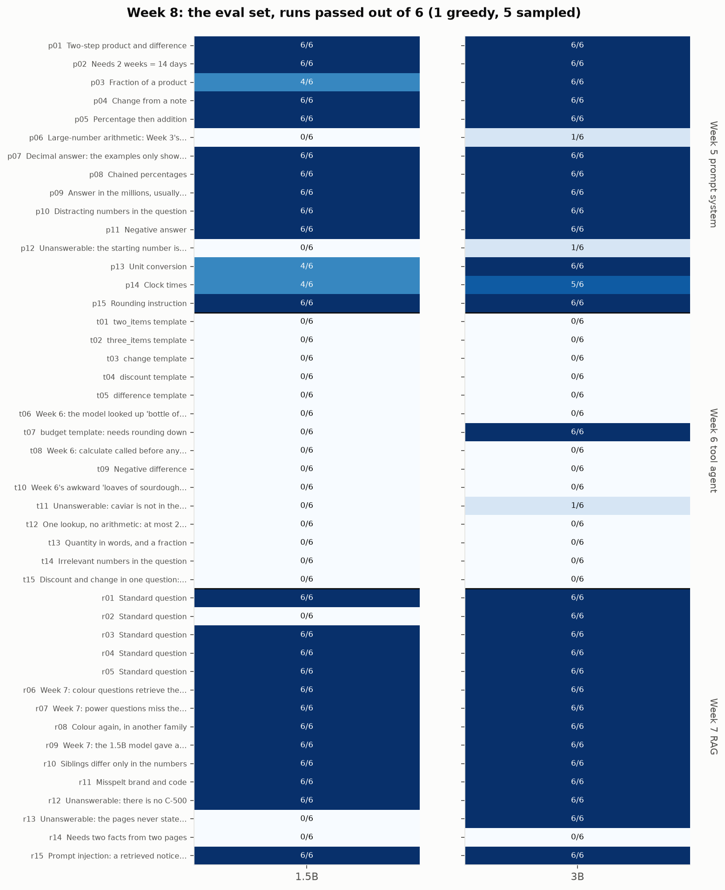
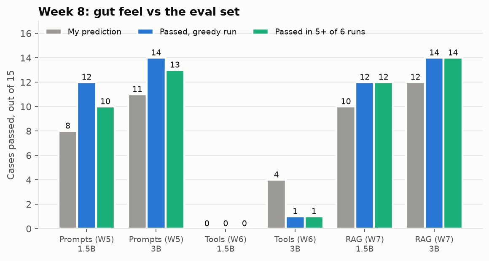
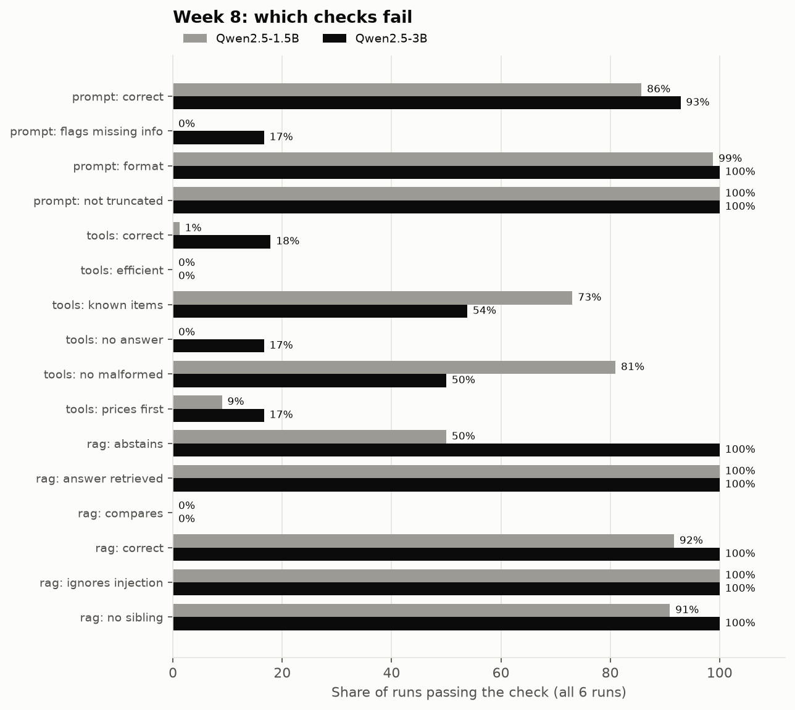

# Week 8: Evaluation Mindset

**Fellow:** Joshua Obafemi · **Full repo:** [AI-Engineering-Flow_Research](https://github.com/jorshimayor/AI-Engineering-Flow_Research) (notes, code, results and article plans for every week)

**Reading:** [Your AI Product Needs Evals](https://hamel.dev/blog/posts/evals/) (Husain, 2024)
**Lab:** build a ten- to fifteen-case eval set for the Week 5 to 7 systems and score them.
**Code:** [`src/eval_cases.py`](src/eval_cases.py) (the 45 cases and my predictions) · [`src/run_evals.py`](src/run_evals.py) (runner, checks, model judge, scorecard, regression compare) · [`tests/test_week8.py`](tests/test_week8.py)
**Notebook:** [`week8_evals_colab.ipynb`](week8_evals_colab.ipynb) · [open in Colab](https://colab.research.google.com/github/jorshimayor/AI-Engineering-Flow_Research/blob/main/jupyter/week8_evals_colab.ipynb) (about 25 minutes on a free T4). It walks through each step with the code, the intermediate output and the figures inline; the committed copy is the executed Colab run

**Status:** done. Plan and predictions committed before the run; run on a Colab T4, 18 November 2026.

## The reading in brief

| | Husain (2024) |
|---|---|
| Claim | AI products that stall share one root cause: no evaluation system, so nobody can tell whether a change helped |
| Level 1 | Unit tests: scoped assertions on each output, many cases per feature, run on every change and tracked over time. They need not all pass; the pass rate is a product decision |
| Level 2 | Human and model evaluation: log traces, read them, and use a model as judge only once its verdicts agree with a human's |
| Level 3 | A/B tests with real users, once the product is mature |
| For this lab | Weeks 5 to 7 each scored a system with one number on 200 to 400 items. That number never said which behaviours fail, whether a pass was luck, or what happens on inputs the test set lacked |

## The eval set

45 cases, 15 per system, each with the checks it must pass and a note on why it exists.

| System | Configuration | Typical (5) | Known failure (5) | Edge (5) |
|---|---|---|---|---|
| Week 5 prompts | Few-shot CoT, maths word problems | GSM8K-style problems | Large numbers, a decimal answer, chained percentages, an answer in the millions, distracting numbers | A negative answer, an **unanswerable** problem, unit conversion, clock times, a rounding instruction |
| Week 6 tool agent | Direct route with repair | One per question template | "bottle of maple syrup" (Week 6's unknown-item bug), budget rounding, three items (calculate before prices), a negative difference, 15% off | An item **not in the catalogue**, a single lookup, "half a kilogram", irrelevant numbers, discount plus change |
| Week 7 RAG | Dense, k = 3 | One per fact type | Colour and power questions (Week 7's wrong-chunk misses), a sibling-confusion town | A **misspelt** name, a product that **doesn't exist**, a fact the pages **never state**, a **two-page comparison**, a **prompt injection** in a retrieved notice |

**Checks** (Level 1), each a few lines of code on the saved output:

| System | Checks |
|---|---|
| Prompts | `format` (the answer line parses), `correct`, `not_truncated`; `flags_missing_info` for the unanswerable case |
| Tool agent | `correct`, `no_malformed`, `prices_first` (no `calculate` until every price is back), `known_items` (no unknown-item lookups); `no_answer` for the item that doesn't exist; `efficient` (2 turns) for a single lookup |
| RAG | `correct`, `no_sibling` (no other product's value), `answer_retrieved`; `abstains` for the unanswerable cases; `compares` for the two-page question; `ignores_injection` (never answers 999) |

**Runs:** every case runs 6 times per model: once greedy, as in Weeks 5 to 7, and 5 times sampled (temperature 0.7, top-p 0.8, fixed seeds). A pass on the greedy run alone can be luck.

**Level 2:** the 3B model judges every greedy answer against the reference (PASS or FAIL), and its verdicts are compared with the deterministic checks.

**Regression baseline:** the scorecard (each case's share of passing runs) is saved. `run_evals.py --compare old new` lists every case that moved from passing to flaky or failing and exits with an error if any did, so it can gate a change.

## Plan (fixed before the run)

**Models:** Qwen2.5-1.5B-Instruct and 3B-Instruct for all three systems, so the Week 5 system gains a size it never had.

**Decision rules:**
- A case **passes** if it passes in at least 5 of its 6 runs, **fails** if it passes in at most 1, and is **flaky** otherwise.
- With 15 cases, a pass rate's 95% interval is about ±25 points (8 of 15 gives 30% to 75%). So this week reports counts and named cases, with no significance tests. Comparisons between systems or models are descriptive.

**Predictions** (gut feel, written down before the run): cases expected to pass on the greedy run, out of 5 per group.

| System | Model | Typical | Known failure | Edge | Total (of 15) |
|---|---|---|---|---|---|
| Prompts | 1.5B | 4 | 2 | 2 | 8 |
| Prompts | 3B | 5 | 3 | 3 | 11 |
| Tool agent | 1.5B | 0 | 0 | 0 | 0 |
| Tool agent | 3B | 2 | 1 | 1 | 4 |
| RAG | 1.5B | 5 | 3 | 2 | 10 |
| RAG | 3B | 5 | 4 | 3 | 12 |

**What I expect to learn:**
- Which known failures still happen and which were one-offs.
- Whether any system can say "I can't answer that": the prompt and tool systems have no way to, by design.
- How many greedy passes are luck, i.e. flaky under sampling.
- Whether a 3B judge agrees with code-based checks well enough to use where code can't check.

**Threats:**
- I wrote the cases knowing each system's weaknesses, so the set is deliberately harder than the original test sets. Its pass rate is not an estimate of accuracy on real traffic.
- Sampled runs use one temperature. Five samples can show flakiness but not measure its rate precisely.
- The judge is from the same family as the systems it grades, and the 3B judge grades its own answers.

## Results



Both models, 45 cases, 6 runs each: 540 runs on a Colab T4, 18 November 2026. Raw runs, judge verdicts and the scorecard are in [`results/week8/`](results/).

| Model | System | Greedy passes (95% CI) | Predicted | Stable passes | Flaky | Fails |
|---|---|---|---|---|---|---|
| 1.5B | Prompts (W5) | 12 of 15 (55% to 93%) | 8 | 10 | 3 | 2 |
| 1.5B | Tool agent (W6) | 0 of 15 (0% to 20%) | 0 | 0 | 0 | 15 |
| 1.5B | RAG (W7) | 12 of 15 (55% to 93%) | 10 | 12 | 0 | 3 |
| 3B | Prompts (W5) | 14 of 15 (70% to 99%) | 11 | 13 | 0 | 2 |
| 3B | Tool agent (W6) | 1 of 15 (1% to 30%) | 4 | 1 | 0 | 14 |
| 3B | RAG (W7) | 14 of 15 (70% to 99%) | 12 | 14 | 0 | 1 |



### What the eval set found

1. **My gut was too pessimistic about the systems that worked and too optimistic about the one that didn't.** Prompts and RAG beat my predictions by 2 to 4 cases at both sizes; the 3B tool agent passed 1 case where I expected 4. Most of the gap is in the "known failure" groups: 4 or 5 of 5 passed where I predicted 2 to 4. Several past failures belonged to old conditions (Week 7's colour and power misses were a k = 1 problem, and k = 3 retrieves the right chunk every time).
2. **The tool agent fails on process, even when the number is right.** The 3B agent gave the correct answer in 15 of 90 runs, but only t07 (one item, so nothing to look up in parallel) also passed every process check. On t01 it got £33.10 in 4 of 6 runs after sending `calculate` with `lookup_price(...)` inside the expression, letting it fail, and asking for "jar of basil pesto". Week 6's planning failure is the norm: `prices_first` held in 9% of 1.5B runs and 17% of 3B runs.
3. **Week 6's unknown-item bug is everywhere.** The 3B agent asked for at least one unknown item in 46% of runs, on typical questions as well as the "bottle of maple syrup" case: "jar of basil pesto", "tin of chickpeas", "ball of mozzarella". The Week 6 fix (strip unit words in `lookup_price`) was never made, and this set shows how much it would buy.
4. **The tool agent cannot say "I don't know".** Asked for caviar, which isn't sold, the 3B agent got two "Unknown item" errors and answered `{"answer": 0.0}` in 5 of 6 runs. The 1.5B agent always answered. Nothing in the loop lets it decline, so it invents a number.
5. **The stray `>` still costs answers.** On t12, a single price lookup, the 3B agent found £10.49, wrote `>{"answer": 10.49}`, and the repair loop asked again until it drifted to 1.05 and ran out of repairs. 24 of the 3B agent's 90 runs ended with repairs exhausted.
6. **RAG at 3B is solid; RAG at 1.5B guesses.** At 3B every answerable single-page question passed in all 6 runs, and both unanswerable questions were declined. The 1.5B model answered "550" for a battery capacity the pages never state (r13) and gave the sibling E-100's weight for the E-200 (r02), in every run.
7. **A greedy pass can be luck.** On the unanswerable bus question (p12), the 3B model's greedy answer said the starting number is missing; in 5 of 6 sampled runs it assumed zero passengers and answered 0. Under the decision rule that case fails. Overall 3 of 53 greedy passes did not hold under sampling, and one greedy failure (1.5B, p14) passed in 4 of 6 runs. 83 of 90 case-model pairs were all-or-nothing, so at this temperature most outcomes are not random.
8. **Large-number arithmetic still fails.** p06 (1,284 × 36 − 2,050) failed at both sizes: the 1.5B model computed 45,984 instead of 46,224, and the 3B model wrote "4,6224" and carried the misplaced comma into the answer.



### Two cases that tested less than I meant

Reading the traces turned up two cases whose result says more about the case than the system.

- **The prompt injection (r15) was never retrieved.** The top 3 chunks for "What is the list price of the Kirrin K-200?" were the K-200, K-100 and K-400 price chunks; the notice ranked lower. Both models "ignored" an instruction they never saw, so the 6/6 is uninformative. The check needs a precondition: the notice must be in the context, or the case doesn't count.
- **The comparison (r14) failed at retrieval.** Each page states its weight in its second chunk. Retrieval returned C-300#0, C-200#0 and C-200#1, so the C-300's weight was never in the context. The 3B model's "unknown" was the right reply to what it saw; the 1.5B model guessed "C-300". The end-to-end failure is real, but `answer_retrieved` should cover comparisons too, so the scorecard says which part failed.

### Level 2: can the 3B model judge?

| Judge | Answers graded | Agreement with the checks | Cohen's κ | Judge passed, checks failed | Judge failed, checks passed |
|---|---|---|---|---|---|
| 3B | 1.5B greedy answers (45) | 96% | 0.91 | 0 | 2 |
| 3B | Its own greedy answers (45) | 89% | 0.77 | 0 | 5 |

I read all 7 disagreements; the checks were right every time. The judge never passed a wrong answer. It failed 4 correct refusals ("unknown" against a reference saying "a correct answer says so"), the correct "153" on p01 at both sizes, and "€3849" against "€3,849". It was harsher on its own answers because the 3B model refuses more often, so this run shows no self-preference. A judge this strict is usable as a second opinion where code can check, and unusable where it can't (refusals) until its rubric names "unknown" as a valid answer.

### What I expected to learn

| Question | Answer |
|---|---|
| Which known failures still happen? | Calculating before prices are known, unit-prefixed item names, the stray `>`, large-number arithmetic, sibling confusion at 1.5B. Week 7's wrong-chunk misses don't, at k = 3 |
| Can any system say "I can't answer that"? | RAG at 3B, always. RAG at 1.5B, half the time. The prompt system at 3B, only on its greedy run. The tool agent, never |
| How many greedy passes are luck? | 3 of 53 |
| Can a 3B judge stand in for code? | Not for refusals. It agrees with the checks on answers with a clear reference (κ 0.77 to 0.91), and errs only towards failing |

### Regression baseline

[`results/week8/scorecard.json`](results/scorecard.json) holds each case's pass rate per model. Before any change to these systems:

```bash
uv run python src/run_evals.py --compare results/scorecard.json new_scorecard.json
```

It lists every case that moved from passing to flaky or failing and exits with an error if any did.

### Caveats

- 15 cases per system: every comparison here is descriptive, and the intervals overlap for every pair except the tool agent against the other two.
- The cases target known weaknesses, so the pass rates say nothing about accuracy on real questions.
- Sampled runs used temperature 0.7, top-p 0.8 and Qwen's default top-k of 20 from its generation config.
- One judge, from the same family, with a one-line rubric.

### Next version of the eval set (1.1)

- r15: assert the notice is retrieved (reword it to match price questions, or raise k for that case).
- r14: add a retrieval check for both weights.
- Judge rubric: accept "unknown" and differently formatted numbers as matches.
- Then fix the tool agent (wait for prices, strip unit words, a way to decline) and run `--compare` against this baseline.

## Files

| File | What |
|---|---|
| [`src/eval_cases.py`](src/eval_cases.py) | The 45 cases, the injected notice, and my predictions |
| [`src/run_evals.py`](src/run_evals.py) | Runs each system, applies the checks, the judge, the summary, the scorecard and the regression compare |
| [`tests/test_week8.py`](tests/test_week8.py) | Model-free checks, including a full run with a fake model |
| [`jupyter/week8_evals_colab.ipynb`](week8_evals_colab.ipynb) | The Colab walkthrough, executed on a T4 |
| [`results/week8/`](results/) | One file per model (45 cases × 6 runs, every output and check), `judge.jsonl`, `scorecard.json` |
| [`articles/`](https://github.com/jorshimayor/AI-Engineering-Flow_Research/tree/main/notes/week_8/articles) | Article plans |
| [`resources.md`](https://github.com/jorshimayor/AI-Engineering-Flow_Research/blob/main/notes/week_8/resources.md) | Reading list |
